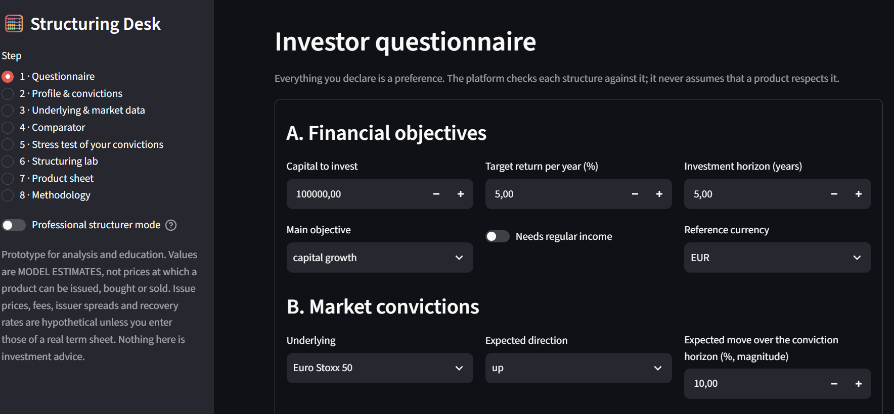
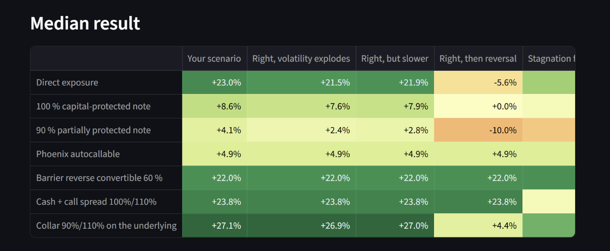
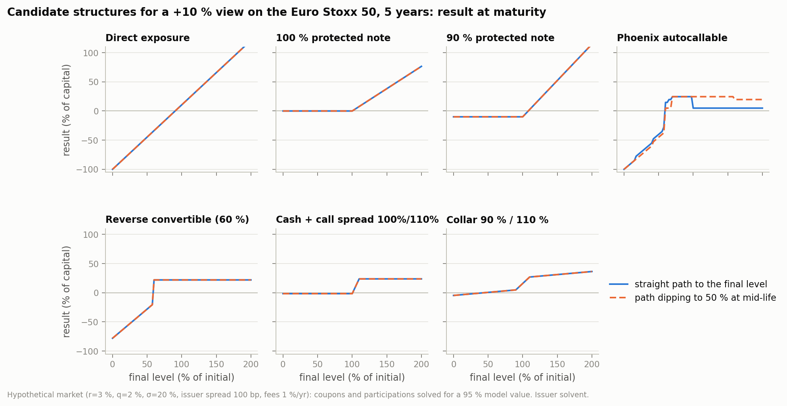
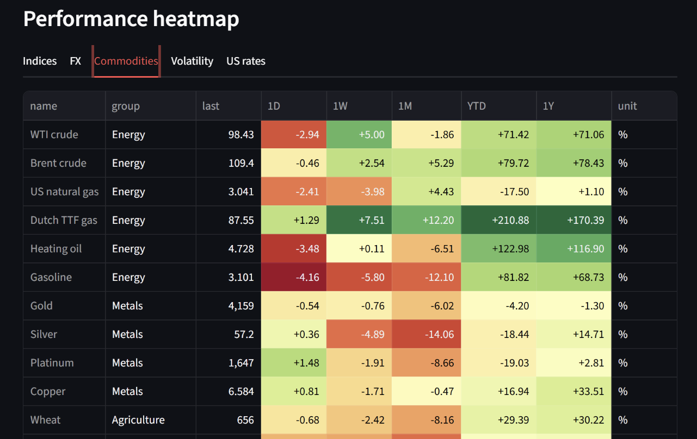
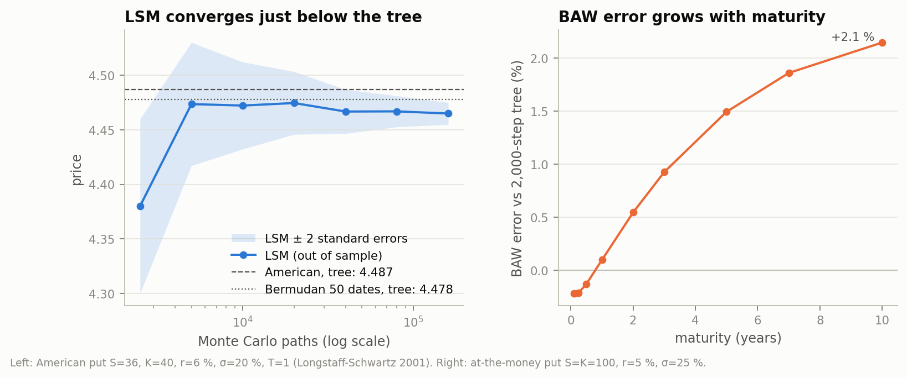
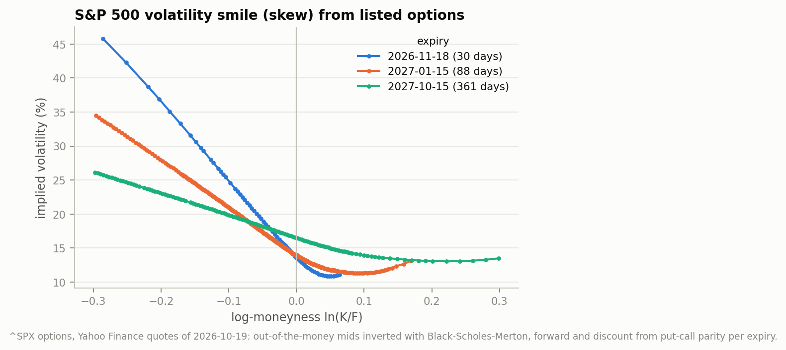
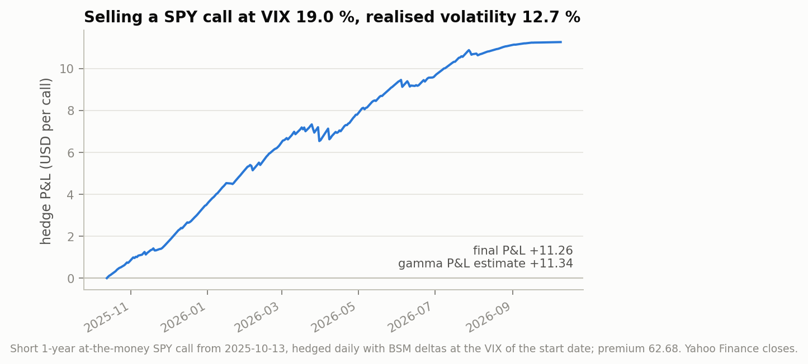
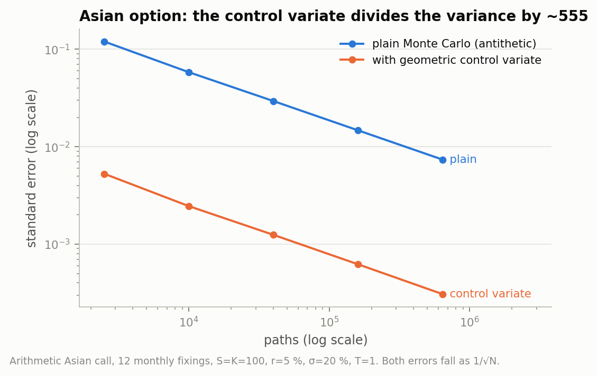
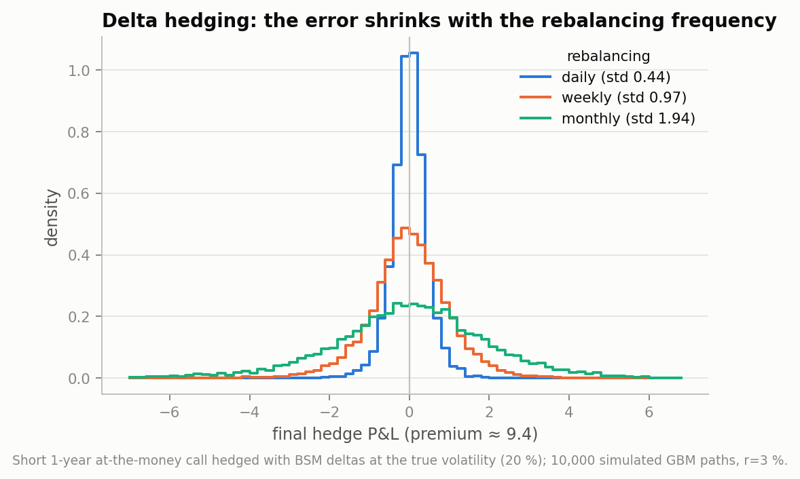

# Derivatives Pricing & Structuring Toolkit

[](https://github.com/ArnaudIllien/derivatives-pricing-and-structuring/actions/workflows/tests.yml)


A Python project covering the main building blocks of a derivatives desk:
- **pricing** options with closed forms, trees and Monte Carlo methods;
- **hedging** them, with a delta-hedging backtest on real prices;
- **reading the market** from free data, through a market dashboard;
- **structuring** products for an investor, from their market view to a comparison of several solutions.

> **About me.** I am Arnaud Illien, an MSc in Finance student at **EDHEC Business School** (Grande École programme). I took derivatives, stochastic analysis and energy trading during a QTEM exchange at the **Technical University of Munich**, and I am currently a Middle Office Analyst intern at **AEW (Natixis Investment Managers)**.
> **I am looking for a 6-month internship from March 2027** in market risk, asset management, structuring or trading.
> [LinkedIn](https://www.linkedin.com/in/arnaud-illien) · arnaud.illien@edhec.com

## Highlights

- **An option pricing library written from scratch.**
  - Black-Scholes-Merton and binomial trees with exact discrete dividends.
  - Barone-Adesi-Whaley, and Longstaff-Schwartz for American and Bermudan options.
  - Asian options priced by Monte Carlo with a control variate.
  - Greeks, and implied volatility surfaces from listed options.
- **Every model checked against an independent one.** Longstaff-Schwartz lands within 0.4–1.3 % of the binomial tree, and below it as theory predicts. Barone-Adesi-Whaley stays within 0.25 % at the money up to one year.
- **Hedging on real prices.** A SPY call was sold at the VIX (19.0 %) while the market then realised 12.7 %. The delta hedge earned +11.26, against +11.34 predicted by the gamma P&L formula.
- **A structured products platform.** It turns an investor's scenario into seven structures (autocallable, reverse convertible, capital-protected notes, option spreads, collar) and solves their coupons. It then values issuer credit, stress-tests the investor's convictions and checks whether each structure beats a simpler alternative.
- **A market dashboard on free APIs**: 73 instruments on four continents, yield curves, electricity prices, macro data and news.
- **213 unit tests** that run without network, on every push.

## Screenshots

**Structuring platform: the investor questionnaire, then the stress test of their convictions.**




**Candidate structures for a +10 % view on the Euro Stoxx 50.** For each one, the result at maturity on a straight path and on a path that dips to 50 %, so barriers and autocalls follow the path.



**Market dashboard: performance heatmap.**



## Quick start

```bash
git clone https://github.com/ArnaudIllien/derivatives-pricing-and-structuring.git
cd derivatives-pricing-and-structuring
pip install -r requirements.txt

python -m structuring.client --report --offline   # text report, no network needed
python -m structuring.client                      # structuring platform (Streamlit)
python -m streamlit run market_watch/app.py       # market dashboard
python -m pricer.client                           # interactive option pricer (terminal)
```

## What is inside

| Folder | Project | Entry point |
|---|---|---|
| [`pricer/`](pricer) | Option pricing library: European, American, Bermudan and Asian options, Greeks, implied volatility, delta hedging | `python -m pricer.client` |
| [`structuring/`](structuring) | Structured Products Intelligence Platform: questionnaire → candidate structures → valuation, scenarios, stress tests, comparison | `python -m structuring.client` |
| [`market_watch/`](market_watch) | Daily market dashboard built on free data sources | `python -m streamlit run market_watch/app.py` |
| [`quant_trading_backtester.ipynb`](quant_trading_backtester.ipynb) | Momentum long/short backtest with a train/test split | Jupyter |
| [`docs/`](docs) | [Mathematics of the models](docs/MATHEMATICS.md), and the script that rebuilds every figure | `python docs/make_figures.py` |

### 1. Option pricing library

| Method | Used for | Validated against |
|---|---|---|
| Black-Scholes-Merton | European options; Bos-Vandermark escrowed dividends | Binomial tree, Monte Carlo |
| Cox-Ross-Rubinstein tree | European, American, Bermudan; exact discrete dividends (Vellekoop-Nieuwenhuis) | Black-Scholes, Monte Carlo |
| Barone-Adesi-Whaley | American options, analytic approximation | Tree |
| Longstaff-Schwartz (LSM) | American and Bermudan options; policy evaluated on independent paths | Tree, including the exact Bermudan tree on the same grid |
| Monte Carlo + control variate | Arithmetic Asian options; geometric Asian in closed form as the control | Closed forms in limit cases |
| Brent inversion | Implied volatility; forward and discount from put-call parity | Round trips on known prices |
| Delta-hedging backtest | Hedge P&L on real or simulated paths | Gamma P&L formula |

The core formula behind each method is in [docs/MATHEMATICS.md](docs/MATHEMATICS.md). For example, the delta-hedged P&L of a short option is a bet on volatility:

$$\text{P\&L} \approx \sum_k \tfrac12\,\Gamma_k S_k^2\left(\sigma_{\text{hedge}}^2\,\Delta t - r_k^2\right).$$

<p>

</p>
<p>


</p>
<p>


</p>

### 2. Structured products platform

It reproduces the workflow of a structurer, in nine steps:

1. **Questionnaire.** Objectives, constraints, and a **described scenario** rather than a single direction. Example: 50 % "+8 % within six months, volatility −3 pts", 30 % stagnation, 20 % "−15 % within a year".
2. **Market data with provenance.** Each parameter shows its source and date, and is tagged in one of three ways:
   - observed: spot, government yields;
   - model estimate: implied or historical volatility, dividends from an ETF proxy;
   - hypothetical: issuer spread, fees, issue price.
3. **Candidate structures.** Their coupons and participations are **solved** so that the model value, including issuer credit, equals the issue price minus costs.
4. **Valuation sheet.** It shows the bond part, the option components valued one by one (they add up exactly to the model value) and the embedded costs.
5. **Scenarios.** The platform shows the result on explicit paths (crash then recovery, V-shape) and the distribution of results under the investor's scenario. Probabilities are always labelled with their hypotheses.
6. **Stress test of the convictions:**
   - the view is right, but volatility explodes;
   - right, but the move is slower;
   - right, then the market reverses;
   - stagnation for the whole life;
   - wrong direction;
   - crash.
7. **Suitability checks.** Every preference is compared with the **contractual** property of each structure. For example, the declared maximum loss is checked against the worst loss the contract allows. A structure is never ranked by its headline return.
8. **Comparison with simple solutions.** Each structure is compared with direct exposure, a do-it-yourself option combination without issuer, and a deposit + underlying mix with the same maximum loss. The platform then says whether the complexity adds value, is dominated, or is a trade-off.
9. **Structuring lab and professional mode.** Every term can be edited, and the cost updates at once. The professional mode shows full Greeks, Monte Carlo convergence and model limits.

The details are in [`structuring/METHODOLOGY.md`](structuring/METHODOLOGY.md).

### 3. Market dashboard

A Streamlit dashboard built only on free sources:
- **Market data from Yahoo Finance**: indices from Europe, the Americas, Asia-Pacific and Africa, FX, commodities, volatility indices.
- **Rates and macro**: US Treasury and ECB yield curves (today, one month and one year ago), FRED macro series.
- **Electricity**: Energy-Charts, plus ENTSO-E and EIA with free keys.
- **News**: Google News, central-bank feeds, GDELT, Finnhub.

It detects **unusual moves** (z-score of the day's return against one year of returns) and links them to headlines. It also includes correlations, a watchlist with alerts, and an option pricer and hedging backtest fed with the day's data.

### 4. Momentum backtester

A daily long/short time-series momentum rule on EUR/USD, with transaction costs and a 70/30 train/test split. The best in-sample window (Sharpe 0.52) gives an out-of-sample Sharpe of −0.65: a clean example of overfitting, and the reason the split matters.

## Key insights

1. **A Monte Carlo exercise policy is a lower bound.** LSM lands 0.4–1.3 % below the tree. The exact Bermudan tree on the same grid splits that gap into two parts: the regression bias, and the cost of exercising on discrete dates only.
2. **A good control variate beats brute force.** The geometric Asian option, which has a closed form, divides the variance by about 555. That is the precision of 555 times more paths.
3. **A delta-hedged option is a volatility trade.** Its P&L is driven by implied minus realised variance: +11.26 on SPY over one year, against +11.34 from the formula. With discrete rebalancing, the error shrinks like √Δt: its standard deviation is 0.44 with daily rebalancing and 1.94 with monthly rebalancing.
4. **Flat volatility flatters products that sell options.** The S&P 500 skew (figure above) makes the down-and-in put embedded in autocallables and reverse convertibles worth more than at the at-the-money volatility. Coupons solved with a flat volatility are therefore too generous.
5. **Issuer credit makes protection cheaper, and riskier.** Discounting at the issuer's spread lowers the cost of the zero-coupon bond. A 100 % protected note can then be built even at zero rates, and part of that "protection" is paid for by the investor bearing default risk.
6. **Complexity has to earn its costs.**
   - A protected note with 10 % embedded costs is dominated by the same protection built with listed calls.
   - An autocallable is not "better" than the index. It is a trade-off: it gives up expected return in exchange for a better adverse case.
7. **Market inputs matter as much as the model.** A smile built with the wrong forward shows a spurious jump at the money. Taking the forward and the discount factor from put-call parity on the listed options removes it.

## Validation results

American puts from Longstaff and Schwartz (2001), table 1 (K = 40, r = 6 %), against a 2,000-step tree. The full table is produced by `python -m pricer.diagnostics`.

| S | σ | T | Tree | BAW | BAW error | LSM (100k paths) |
|---|---|---|---|---|---|---|
| 36 | 0.2 | 1 | 4.4867 | 4.4596 | −0.60 % | 4.4609 |
| 40 | 0.4 | 2 | 6.9236 | 6.9753 | +0.75 % | 6.8872 |
| 44 | 0.2 | 2 | 1.6934 | 1.7331 | +2.34 % | 1.6719 |

## Engineering

- **The engines are separate from the interfaces.** Calculations live in pure Python modules; the Streamlit apps and the terminal clients only display results.
- **Code is reused, not duplicated.** One LSM core serves American and Bermudan options. The structuring platform reuses the pricing library and the dashboard's yield-curve sources.
- **The test suite runs without network.** 213 unit tests check:
  - payoffs on hand-built paths;
  - closed forms against Monte Carlo, within 3 standard errors;
  - limit cases with exact answers;
  - convergence rates;
  - the parsers of every API, on recorded answers.

  GitHub Actions runs them on every push. The Streamlit apps were also driven headlessly.
- **Data honesty.** Market data is never fabricated: every fallback is labelled hypothetical, and a model value is never presented as a price.

## Limitations

- **Volatility.** It is constant: there is no skew dynamics and no stochastic volatility. Barrier and autocallable values are the most affected.
- **Rates.** A flat curve at the maturity yield, so there are no products on interest rates.
- **Issuer credit.** The default intensity is constant, and the spread is a user input, not observed.
- **Scope of the structuring platform.** Single-underlying structures only: no worst-of baskets and no quanto adjustments.
- **Free data.** Yahoo Finance is unofficial and can be delayed. European indices have no free listed options, so their volatility is historical.
- **Longstaff-Schwartz.** Its low bias is not measured by its standard error.
- **Barone-Adesi-Whaley.** Its error grows with maturity: about 2 % at 10 years.
- **Suitability checks.** They are indicative only. They do not replace a MiFID II assessment or a PRIIPs KID.

## Next steps

- **Local or stochastic volatility** (Dupire, Heston), calibrated to the implied volatility surfaces already built here.
- **Hull-White** for rate products and stochastic discounting.
- **Worst-of** structures with a correlation model.
- **The Andersen-Broadie upper bound**, to give a price interval around LSM.
- **Pathwise and likelihood-ratio Greeks**, quasi-Monte Carlo (Sobol sequences), and a Brownian bridge for continuous barriers.
- **A database of real term sheets**, to compare model values with actual issue prices.

<details>
<summary><b>Example output</b> of <code>python -m structuring.client --report --offline</code></summary>

```text
Candidates:
  Direct exposure: terms fixed
  100 % capital-protected note: participation solved: 76.53%
  90 % partially protected note: participation solved: 124.56%
  Phoenix autocallable: coupon solved: 4.91%
  Barrier reverse convertible 60 %: coupon solved: 4.40%
  Cash + call spread 100%/110%: size: 2.53 spreads per unit
  Collar 90%/110% on the underlying: terms fixed

                        structure  maturity (y)           potential return median (your scenario) estimated costs max loss (issuer solvent)                           fit with profile
                  Direct exposure           5.0            uncapped upside                 +22.3%           0.00%                    100.0% Not consistent with the stated constraints
     100 % capital-protected note           5.0            uncapped upside                  +8.1%           5.00%                      0.0%               Consistent with reservations
    90 % partially protected note           5.0            uncapped upside                  +3.2%           5.00%                     10.0%               Consistent with reservations
             Phoenix autocallable           5.0 at most +24.5% (+4.49%/yr)                  +4.9%           5.00%                    100.0% Not consistent with the stated constraints
 Barrier reverse convertible 60 %           5.0 at most +22.0% (+4.06%/yr)                 +22.0%           5.00%                     78.0% Not consistent with the stated constraints
     Cash + call spread 100%/110%           3.0 at most +23.8% (+7.37%/yr)                 +23.8%           0.50%                      1.5%     Consistent with the stated constraints
Collar 90%/110% on the underlying           5.0 at most +36.4% (+6.41%/yr)                 +27.0%           0.50%                      4.6%     Consistent with the stated constraints
```

The market is hypothetical in offline mode: r = 3 %, q = 2 %, σ = 20 %, issuer spread 100 bp, fees 1 % per year. The demo investor accepts at most a 10 % loss, which is why the structures that can lose more fail the suitability check.
</details>

## References

- Black, F. and Scholes, M. (1973), *The Pricing of Options and Corporate Liabilities*; Merton, R. (1973), *Theory of Rational Option Pricing*.
- Cox, J., Ross, S. and Rubinstein, M. (1979), *Option Pricing: A Simplified Approach*.
- Barone-Adesi, G. and Whaley, R. (1987), *Efficient Analytic Approximation of American Option Values*.
- Longstaff, F. and Schwartz, E. (2001), *Valuing American Options by Simulation: A Simple Least-Squares Approach*.
- Kemna, A. and Vorst, A. (1990), *A Pricing Method for Options Based on Average Asset Values*.
- Bos, M. and Vandermark, S. (2002), *Finessing Fixed Dividends*; Vellekoop, M. and Nieuwenhuis, J. (2006), *Efficient Pricing of Derivatives on Assets with Discrete Dividends*.
- Hull, J., *Options, Futures, and Other Derivatives*; Glasserman, P. (2003), *Monte Carlo Methods in Financial Engineering*.

## How this project was built

The project was developed with AI-assisted coding (Claude Code). I defined the scope, the requirements and the design choices of each project. Each model is validated against an independent reference by the test suite. [`CLAUDE.md`](CLAUDE.md) records the project's conventions for the coding assistant.

---

*Educational project. Model values are estimates, not executable prices, and nothing here is investment advice.*
